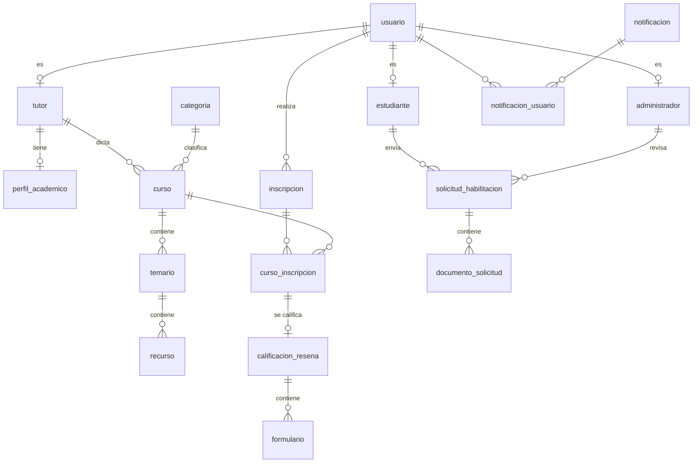

# Diseño de la base de datos — Sistema de Tutorías UAGRM

Base de datos **PostgreSQL 17** generada por las migraciones de `database/migrations/`.
**Referencia oficial:** script del documento del Taller de Grado, cap. 7.3.2.3
(diagrama lógico 7.3.2.1 y mapeo 7.3.2.2).

## 1. Levantar la base de datos

```bash
php artisan migrate --force --seed
```

Crea las 17 tablas con claves, restricciones e índices, y el administrador inicial
si `ADMIN_EMAIL` y `ADMIN_PASSWORD` están en el `.env` (no se duplica si ya existe).
Más administradores: `php artisan admin:crear`.

## 2. Diagrama entidad–relación



## 3. Tablas

**(+)** = columna o regla agregada al script porque la exige una funcionalidad implementada.

| Tabla | Columnas |
|---|---|
| usuario | id_usuario PK identity, nombres v100, apellidos v100, correo v150 único, contrasena v255 (hash bcrypt), telefono v20, facultad v100, tipo_registro v30 (`ESTUDIANTE`/`DOCENTE`/`AUXILIAR`, `ADMINISTRADOR` solo admins), **activo (+)**; **(+)** foto_perfil v255, registro_auxiliar v30 único, codigo_docente v30 único. Teléfono, foto y nombres se editan en Mi perfil; facultad + tipo_registro + registros se registran una sola vez (facultad NOT NULL = completado) |
| estudiante | id_estudiante PK/FK→usuario (cascade), registro v30 único (**(+)** anulable: se completa en Mi perfil; NULL para docentes) |
| tutor | id_tutor PK/FK→usuario (cascade), tipo_academico v30 |
| administrador | id_administrador PK/FK→usuario (cascade), cargo v100 |
| perfil_academico | id_perfil_academico PK, biografia, enlaces, conocimiento (text), id_tutor único FK→tutor |
| categoria | id_categoria PK, nombre v100 único |
| curso | id_curso PK, titulo v150, modalidad v20, cupos, es_gratuito, id_categoria FK, id_tutor FK→tutor; **(+)** descripcion, fecha_inicio, fecha_finalizacion, estado (`BORRADOR`/`PUBLICADO`/`CANCELADO`/`FINALIZADO`), motivo_cancelacion, fecha_cancelacion. **(+)** titulo/modalidad/cupos/es_gratuito/id_categoria anulables mientras el curso es borrador |
| temario | PK (id_curso, id_temario identity), nombre v150, fecha, estado v20; cascade con curso |
| recurso | PK (id_recurso identity, id_temario, id_curso), nombre v150; FK (id_curso,id_temario)→temario cascade |
| inscripcion | id_inscripcion PK, fecha, estado bool (true activa), motivo_cancelacion v500, id_usuario FK→usuario |
| curso_inscripcion | PK (id_inscripcion, id_curso), estado v20: `activa`, `asistio` (tutor registró asistencia), `confirmada` (estudiante confirmó), `cancelada`, `eliminada` (retirado por tutor) |
| calificacion_resena | id_calificacion PK, puntuacion (1–5 **(+)**), fecha, comentario, único (id_inscripcion,id_curso) FK→curso_inscripcion |
| formulario | id_formulario PK, titulo v150, preguntas text, id_calificacion FK cascade |
| solicitud_habilitacion | id_solicitud PK, estado v20 (`pendiente`/`aprobada`/`rechazada`), fecha, comentario_rechazo, id_administrador FK, id_estudiante FK; **(+)** tipo_academico, codigo; **(+)** índice único parcial (id_estudiante) WHERE estado = `pendiente` (una sola solicitud pendiente por estudiante) |
| documento_solicitud | id_documento PK, nombre v150 (tipo de documento), ruta v500 (PDF en `storage/app/private`), id_solicitud FK cascade |
| notificacion | id_notificacion PK, mensaje v500, fecha, estado bool (false = no leída) |
| notificacion_usuario | PK (id_usuario, id_notificacion), ambas FK cascade |

## 4. Reglas de negocio reflejadas en datos

- Un usuario puede ser estudiante y tutor; el administrador es independiente.
- Solo se reseña con participación verificada (`curso_inscripcion.estado` en `asistio`/`confirmada`).
- No se procesan pagos: `es_gratuito` es informativo.
- Cancelar no borra registros: se cambia el estado y se guarda el motivo.
